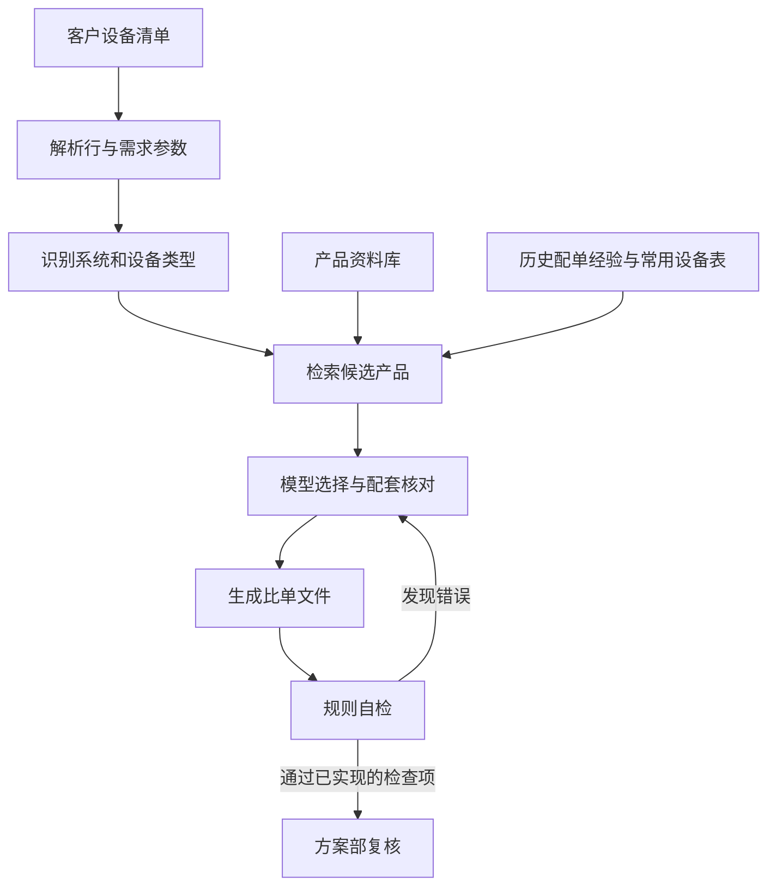

# 企业设备选型 Agent 优化实践

> 面向企业设备清单匹配、配单与方案文件生成的 Agent 项目。

我接手了一个已有的企业内部 Agent。它能读取客户清单、查找产品并生成比单表，但业务人员反馈配单准确率不高：部分型号选错、设备配套不一致，甚至出现客户要求 4K 却选了 2K 产品的情况。

我围绕这些问题主导了业务规则梳理、选型工具优化、评测体系建设和上线迭代，与方案部确认规则和结果，并借助 AI 辅助完成代码修改、测试与部署。

**本仓库包含脱敏后的核心源码、虚构数据演示、回归测试，以及架构、优化方法与历史评测摘要。可以在本地运行工具演示；完整生产 Agent 仍依赖 Hermes、业务资料与内部系统。**

## 快速体验

需要 Python 3.11 或以上。以下演示使用虚构产品和虚构需求单，不调用模型、不访问网络，也不需要 API 密钥。

```bash
pip install -r requirements.txt
python examples/demo.py
python -m unittest discover -s tests -v
```

演示调用实际的 `bidan.py` 和 `kb_tool.py`，完成草稿生成、示例型号选择、Excel 导出和自检，文件保存在 `demo-output/demo_比单表.xlsx`。其中选择步骤按虚构案例预先指定，未运行语言模型，不能用这个演示衡量 Agent 准确率。

## 业务场景

销售或技术人员上传客户设备清单，Agent 逐行匹配企业产品型号、参数与价格，生成供方案部复核的文件。业务支持的输出包括比单表、配置清单、偏离表和文字方案；本次记录中的评测主要覆盖比单任务，其他输出类型的质量未验证。

项目基于已有 Hermes 框架开展应用层优化，主要使用 Python 工具处理检索、校验和 Excel 文件。模型通过终端、文件读写、脚本与技能完成任务。

## 我负责的工作

- 将方案部反馈转为可检查的业务规则，明确产品系统、系列兼容、停单状态和参数约束。
- 主导候选检索、同系列配套查询和文件自检工具的优化。
- 引入历史人工配单经验及常用设备表，辅助候选排序。
- 建立历史业务考题与人工成果对照的评测流程，区分候选命中与最终输出效果。
- 根据失败案例推动修复、测试与上线，保留测试环境和回滚能力。

开发过程使用了 AI 辅助。我的核心工作是识别业务问题、确定优化方向、协调规则确认并验证结果。Hermes 框架和接手前已有能力属于原有基础；本项目未进行模型权重微调。

## 遇到的问题与解决方法

| 问题 | 优化方法 |
| --- | --- |
| 字面相似的产品可能属于不同系统 | 先识别系统和设备类型，再检索候选 |
| 主机与单元或面板不配套 | 引入同系列查询及配套检查 |
| 历史经验偏好掩盖客户硬参数 | 将可可靠提取的分辨率、功率、路数等纳入参数检查 |
| 模型可能忘记执行自检 | 用插件在工具执行及最终回复阶段触发检查、回传错误或显示警示 |
| 大清单逐行反复调查，耗时高 | 使用草稿生成、模型决策、文件生成的分阶段流程 |
| “感觉更准了”难以证明 | 建立真实业务题评测，保留多种评分口径和失败结果 |

## 工作流程



自检只能发现已覆盖且可识别的问题。通过自检不能证明所有参数和业务需求都正确满足。

## 评测结果

以下数据整理自 2026 年 11 月的内部优化记录，未在本仓库重新运行。原始客户题目及答案未公开。

一个混合系统业务案例采用同一模型、同一题目，对原版和优化版各运行一次：

| 指标 | 原版 | 优化版 |
| --- | ---: | ---: |
| 型号完全一致 | 40.7% | 40.7% |
| 型号一致或同小类 | 74.1% | 85.2% |
| 型号一致、同小类或同大类 | 81.5% | 88.9% |
| 自检记录的硬错误 | 1 | 0 |
| 完成时间 | 615 秒 | 525 秒 |

该题有效评分分母为 27 行。原始清单超过 400 行，但许多行属于非主营或无需匹配项目，不能将 400 多行视作评测样本数。

该案例的同小类口径提高 **11.1 个百分点**，耗时减少约 **14.6%**。这只是一次单题对照结果，不能推广为整体准确率提升；同小类匹配也不代表全部参数满足。

不同系统的表现存在差异，会议与视频相关选型仍有不足。更完整的口径与限制见 [评测说明](docs/evaluation.md)。

## 项目中的工程经验

1. 将稳定、可检查的规则放入工具，减少仅依赖提示词的环节。
2. 经验排序需要受系统兼容和需求参数约束。
3. 分开统计工具候选质量、Agent 最终产出和人工业务验收。
4. 保留失败案例，防止只展示最好的一次结果。
5. 隔离评测答案与经验库，避免答案泄漏。
6. 使用测试环境、备份和回滚机制控制上线变更。

## 仓库内容

- `scripts/kb_tool.py`：系统识别、候选排序、配套查询、参数检查与文件自检。
- `scripts/bidan.py`：比单草稿、型号决策录入及 Excel 导出。
- `scripts/exp_build.py`：历史成果经验库构建及评测答案重合排除。
- `plugins/fyys-selfcheck/`：Hermes 工具结果检查与最终回复警示插件。
- `examples/`：虚构目录与无需模型的本地演示。
- `tests/`：关键规则及文件流程回归测试。
- [架构与职责](docs/architecture.md)
- [优化过程与典型问题](docs/optimization.md)
- [评测口径与结果边界](docs/evaluation.md)
- [源码公开范围与运行说明](docs/source-scope.md)

公开内容已移除具体客户名称、真实报价、企业内部地址、账号、密钥及运维命令；原始技能、业务记忆和客户案例未上传。代码保留部分行业产品系列判断，不是对任意厂商通用的选型引擎。仓库尚未附加开源许可证，查看源码不代表获得原始业务资料或代码的开源授权。

